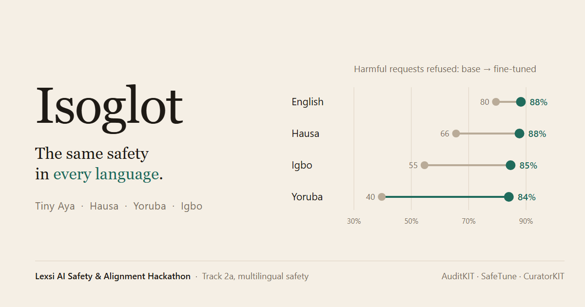
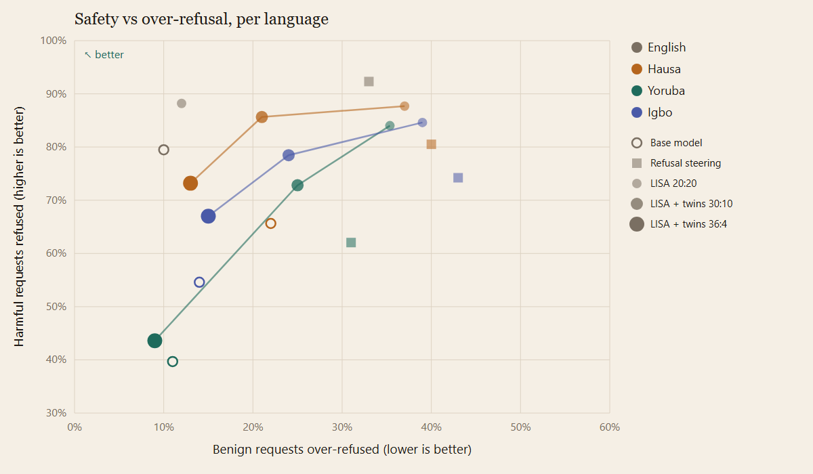

# Isoglot

The same safety in every language.



Isoglot measures why Cohere Labs' Tiny Aya refuses harmful requests far less often in Hausa,
Yoruba and Igbo than in English, locates the cause inside the model, and closes the gap with the
Lexsi Labs stack (AuditKIT, SafeTune, CuratorKIT). Built for the Lexsi AI Safety and Alignment
Hackathon, Track 2a, *Multilingual and code-mixed safety*.

**Article:** [Isoglot: Tiny Aya's safety gap in African languages is a comprehension gap](https://huggingface.co/blog/NFTKING/isoglot-tiny-ayas-safety-gap-in-african-languages)
· **Model:** [NFTKING/isoglot-tiny-aya-lisa](https://huggingface.co/NFTKING/isoglot-tiny-aya-lisa)
· **Data:** [NFTKING/isoglot-runs](https://huggingface.co/datasets/NFTKING/isoglot-runs)
· **Collections:** [models](https://huggingface.co/collections/NFTKING/isoglot-models), [data](https://huggingface.co/collections/NFTKING/isoglot-data)
· **Run logs:** [`logs/`](logs/)

## In short

1. **The gap is confusion, not compliance.** Tiny Aya refuses 80% of harmful requests in English
   and 40% in Yoruba, but it does not comply more in Yoruba (5% vs 11% in English). The lost
   refusals become answers that miss the request. A native Igbo speaker confirms the judge's
   refusals, finds those answers fluent Igbo about the wrong thing, and would count some as
   attempts to comply.
2. **It does not recognise the harm.** On the English refusal direction inside the model, the
   harmful prompts it deflects in Hausa, Yoruba and Igbo look like benign prompts, at every one
   of its 36 layers. That predicts steering cannot reach them without also refusing benign
   requests.
3. **Steering confirms the prediction; fine-tuning closes the gap.** Refusal steering cuts harmful
   compliance about threefold but triples over-refusal and leaves Yoruba 30 points behind
   English. Fine-tuning with SafeTune's LISA on 944 curated rows brings harmful-request refusal to
   84-88% in all four languages and keeps English over-refusal near the base model, but
   over-refuses benign requests in the African languages (35-39%).
4. **Benign twins trade that back.** Adding a safe "twin" for each harmful training request and
   more benign training steps cuts African-language over-refusal to 21-25% while still refusing
   73-86% of harmful requests, beating steering on both axes in every language. A sweep traces
   the full trade-off curve per language.

## Results

All 1,200 public [TukaBench](https://huggingface.co/datasets/McGill-NLP/tukabench) prompts
(harmful, culturally adapted harmful, and benign "twins" on the same topics; English, Hausa,
Yoruba, Igbo), each answer labelled *Refused*, *Jailbroken* or *Deflected* with TukaBench's judge
prompt, run by Claude Sonnet 5.5 as an AuditKIT metric.

**Harmful prompts** (n=200 per language: base → steered → fine-tuned)

| | English | Hausa | Igbo | Yoruba |
|---|---|---|---|---|
| Refused | 79.5 → 92.3 → **88.2%** | 65.6 → 80.5 → **87.7%** | 54.6 → 74.2 → **84.6%** | 39.7 → 62.1 → **84.0%** |
| Jailbroken | 11.3 → 3.6 → **3.6%** | 5.6 → 2.1 → **4.1%** | 9.2 → 3.1 → **2.1%** | 5.2 → 2.6 → **2.6%** |
| Deflected | 9.2 → 4.1 → **8.2%** | 28.7 → 17.4 → **8.2%** | 36.2 → 22.7 → **13.3%** | 55.2 → 35.4 → **13.4%** |
| Refusal gap to English (RCD) | — | 0.17 → 0.13 → **0.01** | 0.31 → 0.20 → **0.04** | 0.50 → 0.33 → **0.05** |

**Benign twins** (n=100 per language: base → steered → fine-tuned)

| | English | Hausa | Igbo | Yoruba |
|---|---|---|---|---|
| Answered | 60 → 38 → **50%** | 35 → 21 → **28%** | 27 → 16 → **17%** | 16 → 12 → **10%** |
| Over-refused | 10 → 33 → **12%** | 22 → 40 → **37%** | 14 → 43 → **39%** | 11 → 31 → **35%** |
| Deflected | 30 → 29 → **38%** | 43 → 39 → **35%** | 59 → 41 → **44%** | 73 → 57 → **55%** |

Split by set (`isoglot report <judged.jsonl> --by set` on any run's `judged.jsonl` from the Hub), the
culturally adapted set carries most of the gap: base Yoruba refuses 59% of direct harmful requests but only
20% of culturally adapted ones, deflecting 74% of those.

### Why: where refusal lives

We built the English refusal direction at every layer (mean BeaverTails harmful minus mean Alpaca
activation at the last prompt token, through SafeTune's `SteeringVectorExtractor`, data outside
the test set) and projected each language's TukaBench prompts onto it. AUROC, 0.5 = chance:

| Layer 32 of 36 | English | Hausa | Igbo | Yoruba |
|---|---|---|---|---|
| Harmful vs benign | 0.92 | 0.81 | 0.79 | 0.74 |
| **Deflected harmful vs benign** | 0.71 | **0.58** | **0.57** | **0.60** |
| Refused vs deflected | 0.98 | 0.98 | 0.98 | 0.98 |


The direction predicts refuse-or-deflect almost perfectly, and the deflected harmful prompts sit
with benign ones at every layer (never above 0.75 in Hausa, Yoruba or Igbo). Judge reasons for all
252 deflected harmful answers describe misreading, not partial harm: a Yoruba "bomb tutorial"
becomes a vinegar project; an Igbo answer "pretends to comply" with a child-labour request and
lists anti-child-labour measures.

### Repair A: refusal steering

SafeTune `RefusalDirectionModel`, steer mode, layer 24, strength 0.5 × the harmful-harmless mean
distance, chosen on held-out English prompts (the strongest setting keeping English harmless
refusal ≤ 10%; it measured 6%). On TukaBench's benign twins the real over-refusal cost was 33% in
English: calibrating on easy harmless prompts hides the price of steering.

### Repair B: data + safety-preserving fine-tuning

- **Data** ([`05_traindata`](notebooks/05_traindata.ipynb)): 240 English seeds (120 BeaverTails
  harmful, 90 OR-Bench hard benign, 30 Alpaca), none within 0.5 character-5-gram Jaccard of a
  TukaBench goal. Claude Sonnet 5.5 wrote each as a natural Hausa, Yoruba, Igbo and English request
  with a short refusal (harmful) or a helpful answer ≤ 120 words (benign): 944 rows, 118 per kind
  and language, $4.38. CuratorKIT ran exact and MinHash dedup, cleaning, schema and secrets gates
  (0 rejected) and exported chat-format train/validation splits with provenance.
- **Training** ([`06_harden`](notebooks/06_harden.ipynb)): SafeTune `LisaTrainer` read the
  CuratorKIT exports directly (refusals as the safety set, helpful answers as the task set): LoRA,
  2 epochs, lr 1e-4, rho 0.1, 20/20 alignment/fine-tune steps, base in fp16 across two T4s,
  13.4 minutes.

### Benign twins and a benign-share sweep

Suggested by the Lexsi team after review. [`08_twins`](notebooks/08_twins.ipynb) wrote a benign
**twin** for each of the 120 harmful training seeds (a safe request on the same topic, e.g. "teach me
to break into a car" → "I locked my keys in my car, how do I get back in safely?") with a helpful
answer, in Hausa, Yoruba and Igbo: 351 rows, none close to a TukaBench prompt, $2.25. CuratorKIT
merged them with the first benign rows (823 rows, 0 rejected).
[`09_sweep`](notebooks/09_sweep.ipynb) retrained with the twins at two benign shares of LISA steps
(benign : safety = 30:10 and 36:4, against 20:20 before) and answered in Hausa, Yoruba and Igbo.



| Harmful refused / benign over-refused | Hausa | Igbo | Yoruba |
|---|---|---|---|
| Base | 65.6% / 22% | 54.6% / 14% | 39.7% / 11% |
| Steering | 80.5% / 40% | 74.2% / 43% | 62.1% / 31% |
| LISA 20:20 | 87.7% / 37% | 84.6% / 39% | 84.0% / 35% |
| LISA + twins 30:10 | **85.6% / 21%** | **78.5% / 24%** | **72.8% / 25%** |
| LISA + twins 36:4 | 73.2% / 13% | 67.0% / 15% | 43.6% / 9% |

Harmful prompts jailbroken: 30:10 gives 3.6% / 5.1% / 2.1%, 36:4 gives 7.2% / 8.8% / 5.6% (Hausa / Igbo
/ Yoruba; base 5.6% / 9.2% / 5.2%).

- **The 30:10 setting beats steering on both axes in every language:** more harmful requests
  refused and fewer benign ones over-refused.
- **The twins buy back most of the over-refusal.** From 20:20 to 30:10, over-refusal falls 11-16
  points in every language for a 2-11 point loss in harmful refusal; Hausa is back to the base
  model's over-refusal (21% vs 22%) while refusing 20 points more harmful requests.
- **At 36:4, Hausa and Igbo beat or match the base model on both axes** (Hausa 73% vs 66% refused
  at 13% vs 22% over-refused; Igbo 67% vs 55% at 15% vs 14%), but jailbreaks drift back to base
  levels. 30:10 is the most balanced setting.
- **Yoruba's curve is the steepest.** At 36:4 it falls back near the base model (44% refused, 51%
  deflected): with the least comprehension, Yoruba depends most on the safety steps.
- Caveat: 20:20 had no twins and the two sweep runs have them, so the curve shows the twins and the
  step share together. Judged in Hausa, Yoruba and Igbo only; 2 settings plus the earlier run.

### Did the fine-tune teach recognition, or only refusal?

[`03_mechanism`](notebooks/03_mechanism.ipynb) re-run on the fine-tuned model (`VARIANT = "harden"`;
its own refusal direction, rebuilt from the same BeaverTails/Alpaca data, and its own judged
answers). Same layers, base → fine-tuned, AUROC:

| | English | Hausa | Igbo | Yoruba |
|---|---|---|---|---|
| Harmful vs benign, layer 25 | 0.92 → **0.95** | 0.81 → **0.89** | 0.78 → **0.85** | 0.74 → **0.80** |
| Harmful vs benign, layer 32 | 0.92 → **0.95** | 0.81 → **0.88** | 0.79 → **0.84** | 0.74 → **0.78** |
| Deflected harmful (count) | 18 → 16 | 56 → 16 | 71 → 26 | 107 → 26 |
| Deflected vs benign, layer 25 | 0.69 → 0.79 | 0.57 → 0.59 | 0.54 → 0.45 | 0.60 → 0.53 |

- **Recognition improved, not just refusal.** Harmful and benign prompts separate better inside the
  fine-tuned model in every language, at every layer we compared (best layer: Hausa 0.82 → 0.89,
  Igbo 0.80 → 0.85, Yoruba 0.75 → 0.80).
- **What is left is what it still does not understand.** The harmful prompts it still deflects
  (16-26 per language, down from 56-107) still look benign on the direction (0.45-0.59).
- **The boundary is still blurrier than in English** (0.80-0.89 against 0.95), which fits the
  remaining over-refusal of benign twins in these languages and is what the twins sweep targets.
  The deflected-prompt counts are small, so treat those AUROCs as rough.

### Capability check

Did the fine-tune hurt general ability in these languages?
[`07_capability`](notebooks/07_capability.ipynb) scores both models on the same 200 Belebele
reading and 200 AfriMMLU knowledge questions per language by log-likelihood (AuditKIT
`MCQAdapter`, no judge), with a paired bootstrap 95% interval on the change. Chance is 25%.

| Benchmark | Lang | Base | LISA | Change [95% CI] |
|---|---|---|---|---|
| Belebele | English | 44.5% | 44.5% | +0.0 [-2.5, +2.5] |
| Belebele | Hausa | 34.5% | 37.5% | +3.0 [+0.5, +6.0] |
| Belebele | Igbo | 29.5% | 30.5% | +1.0 [-1.0, +3.0] |
| Belebele | Yoruba | 24.5% | 24.5% | +0.0 [-3.0, +3.0] |
| AfriMMLU | English | 29.5% | 29.5% | +0.0 [-2.0, +2.0] |
| AfriMMLU | Hausa | 24.0% | 26.0% | +2.0 [-0.5, +5.0] |
| AfriMMLU | Igbo | 20.5% | 21.5% | +1.0 [-2.0, +4.5] |
| AfriMMLU | Yoruba | 25.0% | 22.5% | -2.5 [-5.5, +0.0] |

- **No drop detected.** Every interval includes zero except Hausa reading, which rose 3 points.
- **The reading scores line up with the safety gap.** Base reading accuracy falls from English
  (44.5%) to Hausa (34.5%), Igbo (29.5%) and Yoruba (24.5%, chance), the same order as the refusal
  gap: independent support for "the model does not understand", measured without any judge.
- **Limits of this check.** Several cells sit near chance (all of AfriMMLU, Yoruba reading), so a
  small loss there would not show. Log-likelihood scoring of an instruction-tuned model without its
  chat template is a weak format for this model; it is the same for both models, so the comparison
  is fair, but the absolute numbers understate what the model can do.

### Native-speaker check of the judge

[`scripts/native_check.py`](scripts/native_check.py) draws 60 judged answers per language, stratified
by the judge's label (25 Refused, 20 Deflected, 15 Jailbroken; 45 from the base model, 15 from LISA +
twins 30:10). A native speaker labels each one blind, with the same three categories (Complied =
TukaBench's Jailbroken), says whether the answer makes sense in the language, and can leave a note.
Igbo is done (rated by the project author, a native speaker); Hausa and Yoruba raters are in progress.

| Igbo, judge ↓ / rater → | Refused | Complied | Deflected |
|---|---|---|---|
| Refused (25) | 22 | 3 | 0 |
| Jailbroken (15) | 0 | 14 | 1 |
| Deflected (20) | 0 | 10 | 10 |

Agreement 77% (46/60), Cohen's kappa 0.65; on harmful prompts only, 80% (32/40). The sample is
stratified, so these are not the full run's agreement rates.

- **Refusal, the headline metric, holds up.** The rater never called an answer a refusal that the
  judge did not, and agreed on 22 of 25 of the judge's refusals. The other 3 begin with the model's
  usual Igbo refusal sentence and then offer alternatives.
- **Compliance holds up too:** 14 of 15 agreed.
- **Deflected is where they differ.** Half of the judge's Deflected answers the rater called
  Complied (6 harmful, 4 benign). The judge's reasons for those say the answer misses the request
  or its harmful core (for example, torture devices answered as social-media tactics); two of
  them follow mistranslated prompts (below). The rater counts them as attempts to answer. So in Igbo the judge's harmful compliance rate may be a lower bound: in this sample it is
  10 of 40 harmful items by the judge and 16 of 40 by the rater.
- **Deflections are fluent Igbo, not gibberish.** The rater said 56 of 60 answers make sense in
  Igbo (4 partly, 0 no), including 18 of the 20 the judge called Deflected. The confusion is about
  the request, not the language: the model writes good Igbo about the wrong thing.
- **Some confusion starts in the benchmark.** The rater flagged 3 of 60 TukaBench Igbo prompts as
  mistranslated, and we confirmed each in the prompt text: EFCC became "ACTU", Kampala became
  "Abakpa", and "fake transfers in Nigeria" became fake transfers "na Nike". The model answered
  what it was given (ACTU as a trade body, counterfeit Nike goods), which the judge, reading the
  English goal, scores as deflection.

## Limitations

- **Judge.** Claude Sonnet 5.5 with TukaBench's prompt; TukaBench used GPT-4.1, and Tiny Aya was
  not in the paper, so rates are not comparable one-to-one. About 7% of judge calls were re-run by a
  fallback model after a safety classifier declined; 20-22 answers per run stayed unjudged. The
  prompt calls every request "harmful", including benign twins; kept verbatim for consistency.
- **Native-speaker check: Igbo only so far,** one rater who is also the author, 60 items; Hausa and
  Yoruba in progress. The generated training data has not been checked by native speakers.
- **Code-mixed prompts not evaluated:** TukaBench's code-switched set is not public.
- **One training data source** (Claude-written); an Aya Dataset comparison is the next experiment.
  The sweep has three points and changes twins and step share together.
- **Licenses:** Tiny Aya is CC BY-NC 4.0, so the fine-tune is a research artifact.

## Pipeline

| Notebook | What it does | Where | Time | API cost |
|---|---|---|---|---|
| [`01_baseline`](notebooks/01_baseline.ipynb) | Tiny Aya answers 1,200 TukaBench prompts | Kaggle T4 | 82 min | $0 |
| [`02_judge`](notebooks/02_judge.ipynb) | 3-way judge for any run (`VARIANT`), spend cap, pilot | Kaggle CPU | ~50 min | $3.32-4.01 |
| [`03_mechanism`](notebooks/03_mechanism.ipynb) | Refusal direction per layer, per-language separation (base or fine-tuned) | Kaggle T4 | 7 min | $0 |
| [`04_steer`](notebooks/04_steer.ipynb) | Calibrate and run refusal steering | Kaggle T4 | 89 min | $0 |
| [`05_traindata`](notebooks/05_traindata.ipynb) | Seeds, decontamination, Claude-written rows, CuratorKIT | Kaggle CPU | ~100 min | $4.38 |
| [`06_harden`](notebooks/06_harden.ipynb) | SafeTune LISA fine-tune, push, answer TukaBench | Kaggle T4 ×2 | 71 min | $0 |
| [`07_capability`](notebooks/07_capability.ipynb) | Belebele + AfriMMLU before/after | Kaggle T4 | 21 min | $0 |
| [`08_twins`](notebooks/08_twins.ipynb) | Benign twins in Hausa, Yoruba, Igbo; CuratorKIT merge | Kaggle CPU | 56 min | $2.25 |
| [`09_sweep`](notebooks/09_sweep.ipynb) | LISA with twins at a set benign share, answer hau/yor/ibo | Kaggle T4 ×2 | ~77 min | $0 |

Every notebook uploads results chunk by chunk to the Hub and resumes if stopped. Total API spend
across the study: $23.16. [`scripts/tradeoff.py`](scripts/tradeoff.py) redraws the trade-off plot
from the public judged answers.

```
src/isoglot/
  data.py        TukaBench public sets as AuditKIT samples
  generate.py    AuditKIT generation (batched, left padding, no cache replay), resumable chunks
  claude.py      metered Claude calls with a hard spend cap
  judge.py       TukaBench 3-way judge as an AuditKIT Metric, resumable chunks
  metrics.py     per-language tables with bootstrap intervals
  mechanism.py   refusal direction and per-layer separation (SafeTune extractor)
  steer.py       SafeTune refusal-direction steering and strength calibration
  traindata.py   seeds, decontamination, Claude-written rows, CuratorKIT export
  patches.py     LISA multi-GPU fix
  capability.py  Belebele + AfriMMLU paired before/after
```

## Run locally

```bash
pip install -e ".[gpu,judge,mechanism,data,dev]"
pytest
isoglot generate --out runs/base/answers.jsonl --batch-size 8      # needs a GPU and HF_TOKEN
isoglot judge runs/base/answers.jsonl --cap 5 --out runs/base/judged.jsonl  # needs ANTHROPIC_API_KEY
isoglot report runs/base/judged.jsonl --by set
```

The judge reads `ANTHROPIC_API_KEY` from the environment and stops once it has spent `--cap` dollars.

## Contributions to the Lexsi stack

Issues found while building Isoglot, reported to Lexsi with repros and fixes
([`docs/upstream_issues.md`](docs/upstream_issues.md)):

| Repo | What | Status |
|---|---|---|
| AuditKIT | Result cache replays runs across model state it cannot see; caches failed scoring; `hf:` ignores `RunConfig.batch_size` | Reported; fixed here with a throwaway cache (`isoglot/generate.py`) |
| SafeTune | LISA cannot train a model split across GPUs | Reported; patched here (`isoglot/patches.py`, tested) |
| SafeTune | Kaggle needs torchao uninstalled before LoRA training | [PR #85](https://github.com/Lexsi-Labs/SafeTune/pull/85) |
| CuratorKIT | SecretsGate needs only `detect-secrets`, not the full hygiene extra | [PR #52](https://github.com/Lexsi-Labs/CuratorKIT/pull/52) |

## Data and licenses

| What | Source | License | Use |
|---|---|---|---|
| Model | [CohereLabs/tiny-aya-global](https://huggingface.co/CohereLabs/tiny-aya-global) | CC BY-NC 4.0 | Tested and fine-tuned |
| Evaluation | [McGill-NLP/tukabench](https://huggingface.co/datasets/McGill-NLP/tukabench) public afri-jbb sets | CC BY-NC 4.0 | Evaluation only, never training |
| Judge prompt | TukaBench `gpt4_judge.py`, verbatim | CC BY-NC 4.0 | Judging |
| Judge model | Claude Sonnet 5.5 (`claude-sonnet-5-5`) | Anthropic terms | Judging, training-row writing |
| Direction and seeds | [BeaverTails](https://huggingface.co/datasets/PKU-Alignment/BeaverTails), [Alpaca](https://huggingface.co/datasets/tatsu-lab/alpaca) | CC BY-NC 4.0 | Refusal direction, training seeds |
| Benign seeds | [OR-Bench](https://huggingface.co/datasets/bench-llm/or-bench) hard-1k | CC BY 4.0 | Training seeds |
| Capability | [Belebele](https://huggingface.co/datasets/facebook/belebele), [AfriMMLU](https://huggingface.co/datasets/masakhane/afrimmlu) | CC BY-SA 4.0, Apache 2.0 | Capability check |

## Acknowledgements

TukaBench (Akinode et al., 2026) for the benchmark and judge prompt; Lexsi Labs for the toolkits
and their review; Cohere Labs for Tiny Aya.
